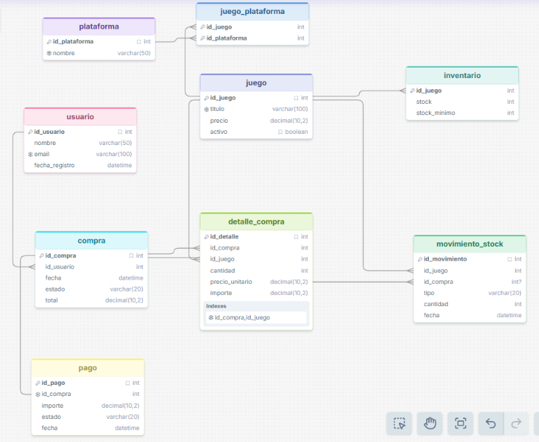

# Tienda de videojuegos · Práctica UD2 JDBC

Aplicación Java de consola que simula la gestión de una **tienda de videojuegos** sobre una base de datos relacional, usando **JDBC directo** (sin JPA ni Hibernate). La misma aplicación funciona con **MySQL** (gestor independiente) o con **H2** (gestor embebido), obteniendo las conexiones con **DriverManager** o con un pool **HikariCP**, sin modificar el código: solo cambiando la configuración.

No tiene menú: al arrancar, reconstruye la base de datos, carga datos de ejemplo y ejecuta una simulación que recorre las operaciones de la tienda, mostrando los resultados leídos de la base de datos.

**Repositorio:** https://github.com/jtcf92/Tienda_de_juegos

---

## Modelo de datos



| Tabla | Contenido |
|---|---|
| `usuario` | Clientes de la tienda (email único) |
| `juego` | Catálogo: título, precio y si está a la venta |
| `plataforma` | PS5, Nintendo Switch, Xbox Series, PC |
| `juego_plataforma` | Plataformas en las que sale cada juego |
| `inventario` | Stock actual y stock mínimo de cada juego |
| `movimiento_stock` | Historial de cambios de stock: `REPOSICION`, `VENTA` o `DEVOLUCION` |
| `compra` | Pedido de un usuario: fecha, estado (`PENDIENTE`, `PAGADA`, `CANCELADA`) y total |
| `detalle_compra` | Líneas de cada compra, con el precio aplicado en ese momento |
| `pago` | Pago simulado de una compra: `PAGADO` o `REEMBOLSADO` |

**Relaciones principales**

- **1:N** — `usuario` → `compra`, `compra` → `detalle_compra`, `juego` → `detalle_compra`, `juego` → `movimiento_stock`.
- **1:1** — `juego` ↔ `inventario` (la clave primaria de `inventario` es la FK al juego) y `compra` ↔ `pago` (FK con `UNIQUE`).
- **N:M** — `juego` ↔ `plataforma`, mediante la tabla intermedia `juego_plataforma`. Es la característica propia de la temática.

Las restricciones (`PRIMARY KEY`, `FOREIGN KEY`, `UNIQUE`, `NOT NULL` y `CHECK`) impiden duplicados, referencias inexistentes, stock negativo y estados no válidos. El dinero se guarda como `DECIMAL(10,2)` y se maneja en Java con `BigDecimal`; las fechas, como `DATETIME` y `LocalDateTime`.

---

## Requisitos

- **JDK 25** (el proyecto compila con `maven.compiler.source/target = 25`).
- **Maven** (o IntelliJ IDEA, que lo incluye).
- **MySQL 8 o superior**, en marcha en `localhost:3306`, solo para el modo `MYSQL`. El usuario debe poder crear bases de datos, tablas y procedimientos (por ejemplo, `root`).
- **H2 no necesita instalación**: va incluido como dependencia de Maven.

Dependencias principales (declaradas en `pom.xml`): `mysql-connector-j`, `h2`, `HikariCP`, `log4j-api`, `log4j-core`, `log4j-slf4j2-impl` y `junit-jupiter` (JUnit 5).

---

## Configuración

La configuración está **fuera del código**, en `application.properties`, que **no se sube a GitHub** porque contiene la contraseña real.

1. Copia la plantilla en la raíz del proyecto:
   ```
   application.properties.example  →  application.properties
   ```
2. En `application.properties`, cambia `mysql.password=CAMBIAR_AQUI` por tu contraseña de MySQL.

| Propiedad | Valores | Para qué sirve |
|---|---|---|
| `database.engine` | `MYSQL` · `H2` | Gestor de base de datos |
| `connection.mode` | `DRIVER_MANAGER` · `POOL` | Conexión nueva en cada operación, o pool HikariCP |
| `simulation.mode` | `NORMAL` · `FALLO_TRANSACCION` | Simulación completa, o demostración del rollback |
| `mysql.url`, `mysql.user`, `mysql.password` | | Datos de conexión a MySQL |
| `h2.url`, `h2.user`, `h2.password` | | Datos de conexión a H2 |
| `pool.maxSize`, `pool.connectionTimeoutMs` | Enteros > 0 | Tamaño máximo del pool y espera máxima (ms) |

La aplicación valida el fichero al arrancar: si falta una propiedad o un valor no es válido, se detiene con un mensaje que indica cuál.

No hace falta crear nada a mano: la base de datos `unidad2` se crea sola en MySQL (`createDatabaseIfNotExist=true`), y en H2 se guarda en el fichero `data/unidad2.mv.db`.

---

## Ejecución

Ejecuta la clase **`tienda.app.Main`** desde IntelliJ, con la raíz del proyecto como directorio de trabajo (allí está `application.properties`). También desde la terminal:

```
mvn compile exec:java -Dexec.mainClass=tienda.app.Main
```

Para cambiar de modo **solo hay que editar `application.properties`**:

| Ejecución | `database.engine` | `connection.mode` | `simulation.mode` |
|---|---|---|---|
| MySQL con conexiones directas | `MYSQL` | `DRIVER_MANAGER` | `NORMAL` |
| MySQL con pool | `MYSQL` | `POOL` | `NORMAL` |
| H2 con conexiones directas | `H2` | `DRIVER_MANAGER` | `NORMAL` |
| H2 con pool | `H2` | `POOL` | `NORMAL` |
| Demostración del rollback | cualquiera | cualquiera | `FALLO_TRANSACCION` |

### Qué hace cada ejecución

1. **Prepara la base de datos**: ejecuta `schema.sql` (borra y crea las 9 tablas), crea el procedimiento almacenado (solo MySQL) y carga los datos de ejemplo en una transacción, usando lotes (`addBatch`/`executeBatch`) y recuperando los ids generados con `getGeneratedKeys()`.
2. **Catálogo y clientes**: alta de un juego y cambio de precio, catálogo filtrado por precio y **paginado en SQL** (`LIMIT`/`OFFSET`), juegos de una plataforma y alta de clientes, incluido un **email repetido** que provoca una violación de integridad analizada con `getMessage()`, `getSQLState()` y `getErrorCode()`.
3. **Inventario**: juegos con stock bajo antes y después de una reposición.
4. **Compras** (modo `NORMAL`): compra correcta y pago, compra rechazada por stock insuficiente, cancelación con devolución de stock y reembolso, segunda cancelación rechazada (no se devuelve el stock dos veces) e historial del cliente.
   **Fallo controlado** (modo `FALLO_TRANSACCION`): la compra falla a propósito después de escribir en varias tablas y antes del `commit`. La aplicación consulta la base de datos antes y después, y comprueba que no queda ninguna compra, detalle ni movimiento, y que el stock no ha cambiado.
5. **Informes**: juegos más vendidos (DTO con `SUM` y `GROUP BY`), stock bajo y llamada al procedimiento almacenado.

---

## Pruebas JUnit 5

```
mvn test
```

o, en IntelliJ, clic derecho sobre `src/test/java/tienda/TiendaTest` → *Run*.

Las pruebas usan **H2 en fichero** (`target/pruebas/tienda.mv.db`) y **no necesitan MySQL**. Antes de cada prueba se borran y crean las tablas y se cargan los datos de ejemplo, por lo que son reproducibles.

| Prueba | Qué comprueba |
|---|---|
| `insertarYConsultarUsuario` | Un usuario insertado se recupera con los mismos datos |
| `cambiarPrecioModificaLaBaseDeDatos` | El `UPDATE` del precio queda guardado |
| `altaDeJuegoUsaElIdGeneradoEnElInventario` | El id generado del juego se usa en su fila de inventario |
| `masVendidosDevuelveUnidadesEIngresos` | La consulta agregada devuelve el DTO con los valores correctos |
| `compraCorrectaGuardaTodasLasTablas` | El `commit` guarda compra, detalles, movimientos y stock |
| `falloControladoDeshaceTodaLaCompra` | El fallo simulado deshace todo y el estado de la BD no cambia |

---

## Cómo comprobar los resultados

- **Consola**: muestra los mensajes `INFO`, `WARN` y `ERROR` de la ejecución.
- **Evidencias** (`logs/evidencias/ejecucion_dd-MM-yyyy_HH-mm-ss.log`): un fichero completo por ejecución, incluidos los mensajes `DEBUG`. El repositorio conserva tres: MySQL con pool en modo normal, H2 en modo normal y `FALLO_TRANSACCION`.
- **Log de ejecución** (`logs/runtime/aplicacion.log`): se rota al llegar a 50 KB y los ficheros antiguos se comprimen en `.gz` (como máximo 5). No se sube al repositorio.
- **Base de datos**: tras una ejecución normal con MySQL, se puede comprobar en Workbench:
  ```sql
  USE unidad2;
  SELECT * FROM compra;                                    -- compra 1 CANCELADA y compra 2 PAGADA
  SELECT * FROM pago;                                      -- pago 1 REEMBOLSADO y pago 2 PAGADO
  SELECT tipo, COUNT(*) FROM movimiento_stock GROUP BY tipo;
  SELECT j.titulo, i.stock FROM inventario i JOIN juego j ON j.id_juego = i.id_juego;
  ```

---

## Diferencias entre MySQL y H2

| Aspecto | MySQL | H2 |
|---|---|---|
| Instalación | Servidor independiente | Embebido, incluido como dependencia |
| Procedimiento `sp_ventas_juego` | Se crea y se llama con `CallableStatement` | **No se ejecuta**: la aplicación lo indica con un `WARN` y continúa. Es una limitación del gestor, no un fallo |
| Compatibilidad SQL | — | Funciona en `MODE=MySQL` con `DATABASE_TO_LOWER=TRUE`, por lo que comparte el mismo `schema.sql` |
| Violación de integridad (email repetido) | `SQLState=23000`, código `1062` | `SQLState=23505`, código `23505` |

En los dos casos el SQLState empieza por `23` (violación de integridad), que es lo que usa la aplicación para reconocerla.

---

## Estructura del proyecto

```
src/main/java/tienda/
├── app/         Main (arranque) y Simulador (escenarios de demostración)
├── config/      Lectura y validación de application.properties
├── conexion/    ConnectionProvider con DriverManager o HikariCP, y la fábrica que elige uno
├── bd/          Creación del esquema y carga inicial de datos
├── modelo/      Records de las entidades y enums de estado
├── dto/         Objetos con los resultados de consultas concretas
├── dao/         Acceso a datos con JDBC: SQL y mapeo de ResultSet
├── servicio/    Operaciones de la tienda y control de transacciones (commit/rollback)
└── excepcion/   NegocioException para las reglas de la tienda
src/main/resources/
├── schema.sql                Tablas del modelo (MySQL y H2)
├── procedimiento_mysql.sql   Procedimiento almacenado (solo MySQL)
└── log4j2.xml                Configuración de los logs
src/test/java/tienda/TiendaTest.java   Pruebas JUnit 5
docs/diagrama-er.png                    Diagrama entidad-relación
logs/evidencias/                        Evidencias de ejecución
IA.md                                   Uso de inteligencia artificial
```

Los DAO reciben siempre la `Connection` como parámetro y no saben si viene de DriverManager o de HikariCP. Los servicios abren la conexión, coordinan varios DAO con esa misma conexión y deciden el `commit` o el `rollback`.